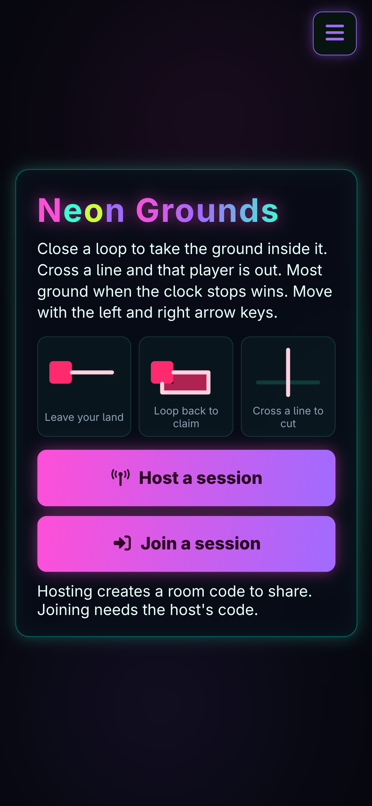
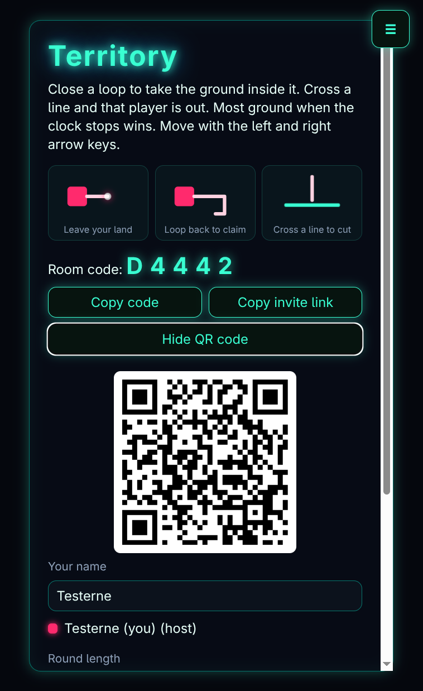
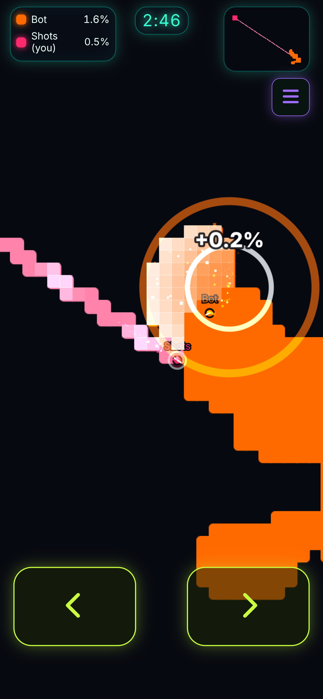

# Territory

**[▶ Play now!](https://isaaceliape.github.io/territory/play/) — free, no ads, no signup, nothing to install.**

Steal ground, cut lines, and snake your way to the biggest patch of neon on the map. Territory is a fast multiplayer turf war for up to 12 players that runs entirely in the browser — on your phone on the couch, or on a laptop across the internet.

## Play with friends in 30 seconds

No accounts, no lobbies to grind, no server to rent. One of you taps **Host a session**, gets a 5-letter room code, and everyone else is in:

- **Type the code** — open the page anywhere and join with a name.
- **Tap the invite link** — it fills the code in for you.
- **Scan the QR code** — point your phone camera at the host's screen and you join straight away, no typing at all.

Up to 12 seats per room. Short a few humans? Add bots (Easy, Normal, Hard) to fill the map. Rounds run 1–5 minutes, so there's always time for "just one more".

And the party survives disaster: if the host's tab closes mid-round, the room carries on — the lowest-id player still connected automatically takes over under the same room code, seats kept, no restart needed.

## Why it's fun

You own a patch of land and drive a snake that never stops. Leave your land and you draw a live wire behind you: loop back home and everything inside is yours. But while that line is out, anyone who touches it kills you — and their exposed lines kill them right back.

That one tension is the whole game, and it never gets old:

- **Greed vs. safety.** A huge loop wins the round and paints half the map your color. It also leaves a mile of line for someone to cut.
- **Cuts.** See an enemy line pulsing red near your head? Drive through it and they're gone. Watch your own the same way.
- **Combacks.** Got boxed in? Your land stays yours, and one good loop steals it all back. Only the survivor takes the crown, so every round has a finish worth playing.
- **Bots with personality.** Easy wobbles home early, Normal plays it straight, Hard hunts your exposed lines. Bots never die stupidly — they bounce off walls — so beating them means outplaying them.
- **Photo finishes.** Most land when the clock stops wins. Ties break on kills. Simultaneous double knockouts both count.

## Made for phones, great everywhere

- **Touch controls** — two big turn buttons appear while you're alive. No pinch, no virtual joystick.
- **Installable** — add it to your home screen and it opens full-screen like a native app, then loads from cache.
- **Plays anywhere** — peer-to-peer over WebRTC, so game traffic flies straight between browsers. Free public hosting, zero servers to pay for, zero ads to sit through.
- **Tune it your way** — the hamburger menu holds music, sound effects, cursor steering, an FPS readout, a mini-map toggle, and (for the host) Restart. Your choices are remembered.
- **Juice included** — captures flash, deaths burst, winners get confetti, and a retro arcade loop (plus synthesized fallback) backs the whole thing. Calms down automatically with your system's reduce-motion setting.

## The 10-second rules

- Close a loop to take the ground inside it.
- Cross a line and that player is out — including you.
- Your line is only vulnerable outside your land.
- Standing on old enemy land is safe; only fresh captures kill.
- Most ground when the clock stops wins.

Theme: "Retro Arcade Game Music" by MondaMusic ([Pixabay](https://pixabay.com/music/video-games-retro-arcade-game-music-512837/), free under the Pixabay Content License).
